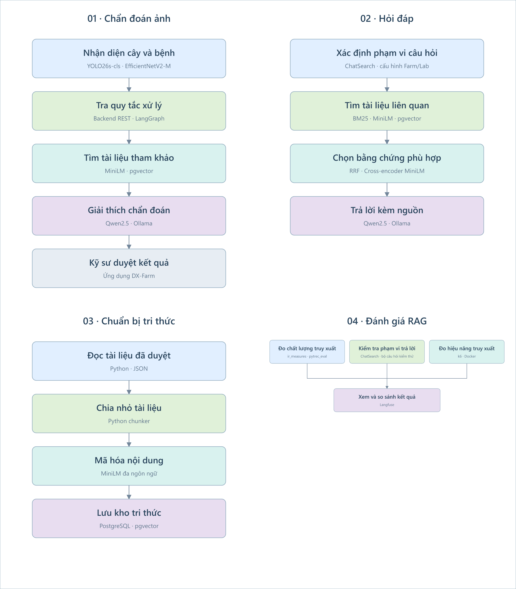

# Đánh giá AI

Tài liệu tổng hợp chỉ số CV, truy xuất RAG và hiệu năng retrieval.

Kết quả model bệnh DX-Farm EfficientNetV2-M do người huấn luyện cung cấp; không chấm lại accuracy trong đợt tích hợp.
Các phép thử bộ lọc ảnh ở mục 3.2 và 3.4 giữ kết quả trước đây vì bộ lọc không thay đổi.

## 1. Phạm vi

| Hạng mục | Giá trị |
|---|---|
| Mô hình | DX-Farm-EfficientNetV2-M 4.0.0: Healthy, Blast, Brown Spot, Leaf Smut, Rice Tungro, Sheath Blight |
| Tiền xử lý model bệnh | RGB/EXIF, resize toàn ảnh 480×480 bicubic có antialias, chuẩn hóa ImageNet, softmax sáu lớp và top-1 |
| Bộ lọc ảnh | Kích thước, độ nét (có nhánh cho ảnh nền đơn sắc), độ sáng, bộ phân loại cây trồng (ngưỡng lúa 0.80) |
| Ngưỡng | Workflow nhận confidence từ 0.70, kỹ sư vẫn duyệt kết luận |
| Mã chạy | `PlantDiseaseService` và `assess_image` của service thật, qua `python -m scripts.evaluate_cv <thư mục>` |

## 2. Bộ ảnh

- Model bệnh: tập test 1.466 ảnh RiceLeafDiseaseBD v3, DOI `10.17632/86s4jzj2m4.3`, CC BY 4.0, theo báo cáo người huấn luyện.
- Bộ lọc ảnh: phép thử trước đây dùng 100 ảnh Dhan-Shomadhan (Mendeley Data, DOI `10.17632/znsxdctwtt.1`, CC BY 4.0), chia đều năm nhóm và hai loại nền Field/White.
- Bộ ảnh kiểm bộ lọc không phải tập chấm model bệnh mới.
- Ảnh không phải lúa để thử bộ phân loại: 15 ảnh ngô (`Project-AgML/corn_leaf_disease_classification`) và 15 ảnh mía (`Project-AgML/sugarcane_leaf_disease_classification`).

## 3. Kết quả

### 3.1. Model bệnh theo báo cáo người huấn luyện

| Lớp | Precision | Recall | F1 | Số ảnh |
|---|---:|---:|---:|---:|
| Healthy | 0.908333 | 0.923729 | 0.915966 | 236 |
| Blast | 0.886486 | 0.824121 | 0.854167 | 199 |
| Brown Spot | 0.849558 | 0.880734 | 0.864865 | 327 |
| Leaf Smut | 0.770642 | 0.777778 | 0.774194 | 108 |
| Rice Tungro | 0.932927 | 0.908012 | 0.920301 | 337 |
| Sheath Blight | 0.947170 | 0.969112 | 0.958015 | 259 |
| Macro avg | 0.882519 | 0.880581 | 0.881251 | 1466 |
| Weighted avg | 0.894629 | 0.894270 | 0.894160 | 1466 |

Accuracy 0.894270 (89,43%); đây là chỉ số classifier, không phải độ chính xác toàn pipeline có quality/crop gate.

### 3.2. Bộ lọc ảnh

| Nền | Số ảnh | Qua bộ lọc | Bị chặn ở độ nét | Bị chặn ở bộ phân loại cây trồng |
|---|---|---|---|---|
| Field | 50 | 41 | 1 | 8 (5 Rice Tungro, 2 Brown Spot, 1 Leaf Scald) |
| White | 50 | 49 | 1 | 0 |

Độ nét được kiểm trên 17 ảnh mỗi nền, kèm bản làm mờ nhân tạo (Gaussian 0.2% và 0.4% cạnh dài) và bản làm mờ 0.4% cộng nhiễu hạt 4, 8, 12 mức xám:

| Nền | Ảnh gốc đạt | Làm mờ 0.4% đạt | Làm mờ 0.4% kèm nhiễu 4, 8, 12 đạt |
|---|---|---|---|
| Field | 17/17 | 0/17 | 0/17 mỗi mức |
| White | 16/17 | 0/17 | 0/17 mỗi mức |

Làm mờ 0.2% cho 9/17 ảnh Field và 0/17 ảnh White đạt; kèm nhiễu 12 thì 1/17 ảnh White đạt.

### 3.3. Ngưỡng workflow

Giữ ngưỡng 0.70 và so trên confidence chưa làm tròn.
Báo cáo được cung cấp chưa đo riêng precision/recall hoặc tỉ lệ nhận ảnh tại ngưỡng này.
Healthy là lớp được huấn luyện, không suy ra từ việc model không phát hiện được bệnh.

### 3.4. Bộ phân loại cây trồng với ảnh không phải lúa

| Bộ ảnh | Số ảnh | Bị nhận là lúa |
|---|---|---|
| Ngô | 15 | 6 |
| Mía | 15 | 15 |

## 4. Nhận xét

1. Sheath Blight có F1 cao nhất (0.958015), Leaf Smut thấp nhất (0.774194) trong báo cáo người huấn luyện.
2. Confidence từ 0.70 vẫn cần kỹ sư duyệt; chưa có đánh giá độc lập về độ tin cậy ngoài tập test.
3. Bộ lọc độ nét nhận ảnh nền trắng đồng nhất; ảnh làm mờ và ảnh mờ có nhiễu hạt bị chặn.
4. Bộ phân loại cây trồng chặn 8/50 ảnh lúa nền ruộng, nặng nhất ở Rice Tungro (lá vàng cam), và nhận mía, ngô là lúa vì chỉ có 10 lớp, không có lớp ngô, mía, cỏ.
5. Classifier sáu lớp chưa có cơ chế nhận biết bệnh ngoài tập nhãn; ảnh lạ có thể bị gán một lớp với confidence cao.

## 5. Giới hạn của phép thử

- Chỉ số model mới là báo cáo của người huấn luyện trên tập test dự án, chưa phải đánh giá độc lập theo cây/ruộng.
- Phép thử bộ lọc dùng 100 ảnh, mỗi ô 10 ảnh nên khoảng tin cậy còn rộng.
- Ảnh mờ là mờ nhân tạo, chưa có ảnh mờ do rung tay hay lệch tiêu cự thật.
- Các ngưỡng độ nét, lúa và 0.70 chưa đo trên ảnh ngoài ruộng của hợp tác xã.
- Ảnh không phải lúa chỉ gồm ngô và mía, chưa có cỏ dại và lúa mì.

## 6. Hướng cải thiện

- Chụp từ 100 ảnh ruộng thật của hợp tác xã, kỹ sư gán nhãn, rồi chạy lại phép thử này làm mốc.
- Bổ sung ảnh thực địa và dữ liệu cho Leaf Smut, kiểm tra các cặp bệnh hay nhầm trước khi huấn luyện thêm classifier.
- Thay hoặc huấn luyện thêm bộ phân loại cây trồng với lớp ngô, mía, cỏ dại, lúa mì.
- Ghi confusion matrix và chỉ số theo lớp khi có đủ mẫu.

## 7. Đánh giá truy xuất RAG

Đo ngày 28/10/2026 bằng `ir_measures`: 27 câu Farm, 39 câu Lab trên 25 tài liệu, 244 đoạn.
Tổng bộ đề có 72 câu, gồm thêm 6 câu chẩn đoán. Chủ dự án đã duyệt 42 câu pilot; 30 câu mở rộng còn nhãn nháp. Dataset vẫn là `draft`, chưa được đánh giá độc lập.
Điểm được tính sau bước lọc truy xuất, trước khi Backend gộp các đoạn tài liệu.

| Strategy | Farm Recall@4 | Farm nDCG@4 | Lab Recall@4 | Lab nDCG@4 |
|---|---:|---:|---:|---:|
| Cosine + boost | 0,521605 | 0,458521 | 0,730769 | 0,674168 |
| BM25 | 0,487654 | 0,500554 | 0,769231 | 0,749210 |
| BM25 + cosine/RRF | 0,555556 | 0,492140 | 0,782051 | 0,733912 |
| Hybrid + rerank | 0,648148 | 0,602363 | 0,762821 | 0,703415 |

**Recall@4** đo tỷ lệ đoạn liên quan tìm được trong bốn kết quả đầu; **nDCG@4** đo mức ưu tiên đoạn hữu ích ở đầu danh sách.
Điểm từ 0–1, càng cao càng tốt; chỉ đánh giá truy xuất tài liệu.
Hybrid + rerank cao nhất trên Farm; Lab có Recall@4 cao nhất với hybrid/RRF, nDCG@4 cao nhất với BM25. Chatbot hiện mặc định dùng hybrid + rerank cho cả hai namespace.

Sáu câu tham khảo chẩn đoán đạt Recall@3 và nDCG@3 bằng 1,0 với mã bệnh cho sẵn; không đo độ đúng CV hoặc toàn pipeline chẩn đoán.

Cách chạy và xem kết quả trên Langfuse: [`ai/README.md`](https://github.com/HaUI-ImplSolution/DX-OS/blob/main/ai/README.md#đánh-giá-truy-xuất-rag).

## 8. Thử tải HTTP retrieval

Đo ngày 28/10/2026 bằng k6: 1.369 request qua 12 lượt, không ghi nhận lỗi HTTP, sai định dạng phản hồi hoặc hết bộ nhớ.
Mỗi mức tải chạy 10 giây sau khi làm nóng model, lặp một lần; AI dùng 2 CPU, 1.536 MiB RAM và một worker.
Mỗi người dùng gửi yêu cầu tiếp theo sau khi nhận phản hồi, với thời gian chờ tối đa 20 giây.

| Nhóm | VU | Cosine req/s | Cosine p95 (ms) | Hybrid + rerank req/s | Hybrid + rerank p95 (ms) |
|---|---:|---:|---:|---:|---:|
| Farm | 1 | 33,78 | 45,54 | 0,83 | 1561,44 |
| Farm | 2 | 17,06 | 294,65 | 0,91 | 2376,22 |
| Farm | 5 | 7,95 | 931,89 | 0,87 | 6145,04 |
| Lab | 1 | 36,37 | 35,67 | 1,07 | 1139,32 |
| Lab | 2 | 22,42 | 168,70 | 0,98 | 2668,25 |
| Lab | 5 | 11,84 | 598,11 | 1,07 | 4869,63 |

**VU** là số người dùng đồng thời; **req/s** là số yêu cầu xử lý mỗi giây; **p95** là thời gian mà 95% yêu cầu không vượt quá.
RAM đỉnh đo bằng `docker stats`: AI cosine 1.112,1 MiB, AI hybrid + rerank 1.413,1 MiB; pgvector 34,3 MiB.
Hybrid + rerank đạt 0,83–1,07 req/s; p95 tăng tới 6,15 giây ở 5 VU. Phép đo chỉ gồm `/api/v1/knowledge/search` trên máy dùng chung; không gồm CV, Backend/gateway hoặc Qwen.

Cách chạy và xem báo cáo: [`ai/README.md`](https://github.com/HaUI-ImplSolution/DX-OS/blob/main/ai/README.md#thử-tải-http-retrieval).
Runner mặc định chạy 36 lượt, 30 giây mỗi mức, lặp ba lần; bảng trên là kết quả chạy rút gọn, chưa phải kết quả cấu hình mặc định.

## 9. Đánh giá nhận biết phạm vi và khả năng trả lời

| Hạng mục | Hiện trạng |
|---|---|
| Bộ đề | 75 câu scope (45 trong miền, 30 ngoài miền) + 15 ca trong miền nhưng kho tri thức không đủ thông tin để trả lời |
| Phép đo | `ChatSearch` thật qua `evaluate_scope.py --live`, đã nối vào runner `quality` |
| Chỉ số | Precision, Recall, F1 về scope; số ca nhận biết đúng khi không đủ thông tin để trả lời |
| Kết quả | Đã được kiểm tra; điểm scope chưa được ghi trong tài liệu này |

Chế độ không có `--live` chỉ kiểm gate legacy, không đại diện chatbot hiện tại.

## 10. Chất lượng câu trả lời Qwen

| Hạng mục | Hiện trạng |
|---|---|
| Phạm vi | Hỏi đáp Farm/Lab; giải thích chẩn đoán khi bật `include_explanation` |
| Kiểm tra đã có | Test hợp đồng với model giả: schema, nguồn, nội dung bị cấm, fallback và giữ nguyên quy tắc điều trị |
| Chất lượng nội dung | Chưa có bảng chấm bởi người duyệt; chưa có điểm chất lượng Qwen trong runner Langfuse |
| Hiệu năng | Chưa nằm trong kết quả tải ở mục 8 |

Tỷ lệ trả lời `generated` không phải tỷ lệ trả lời đúng. Phần cần chấm tiếp: đúng trọng tâm, bám nguồn, dễ đọc và từ chối đúng khi thiếu bằng chứng.

## 11. Kết quả trên Langfuse

Langfuse hiển thị kết quả đã lưu của ba nhóm: retrieval, scope và tải HTTP. Thời lượng trace là thời gian replay/publish, không phải độ trễ suy luận.

| Kết quả cần đối chiếu | Artifact |
|---|---|
| Recall/nDCG và so sánh strategy | `score.json`, `comparison.json` |
| Phạm vi và khả năng trả lời | `scope.json` |
| Tải HTTP, CPU/RAM | `performance-*/benchmark.json` |
| Phiên bản code, model và dữ liệu | `ingest.json`, `collect.json`, `dataset.json` |

Các bảng ngày 28/10/2026 giữ số liệu đã công bố; chưa bổ sung run ID hoặc liên kết experiment để đối chiếu trực tiếp. Cách chạy và mở lịch sử: [`ai/README.md`](https://github.com/HaUI-ImplSolution/DX-OS/blob/main/ai/README.md#đánh-giá-truy-xuất-rag).
